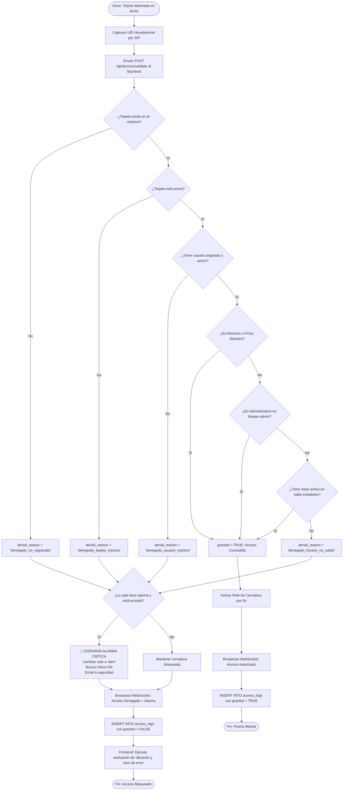
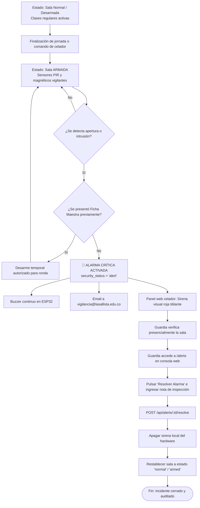
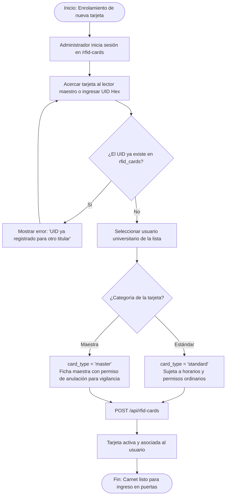

# ⚡ Diagramas de Actividad del Sistema

## Ecosistema Inteligente de Control de Acceso RFID y Monitoreo Institucional
**Corporación Universitaria Lasallista — Caldas, Antioquia**

---

## AD-001: Motor Central de Decisión y Validación de Acceso RFID

Representa la lógica de bifurcación ejecutada en milisegundos cuando una tarjeta física toca un lector en cualquier puerta del campus.

---

## AD-002: Ciclo de Vida y Protocolo de Resolución de Alarmas Críticas

Modela el protocolo de seguridad física desplegado para la protección de la Sala de Informática 1 y espacios restringidos.

---

## AD-003: Proceso de Enrolamiento y Categorización de Tarjetas RFID

Describe el flujo de captura y vinculación de carnets para nuevos integrantes del campus.

