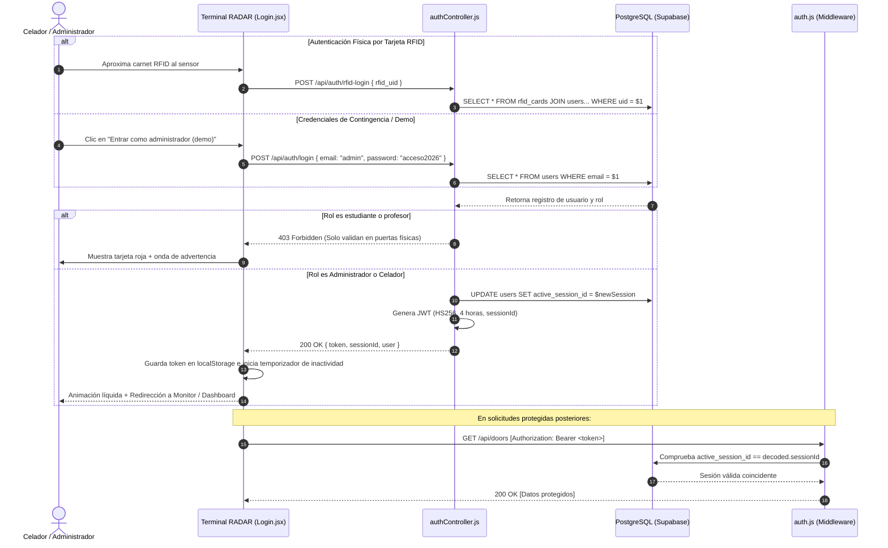

# 🔐 Autenticación y Control de Acceso (RBAC)

## Ecosistema Inteligente de Control de Acceso RFID y Monitoreo Institucional
**Corporación Universitaria Lasallista — Caldas, Antioquia**

---

## 1. Filosofía de Seguridad y Separación de Canales

El ecosistema aplica el principio de **menor privilegio** mediante una arquitectura de dos canales completamente desacoplados:

```
┌────────────────────────────────────────────────────────────────────────┐
│                   CANAL 1: ACCESO FÍSICO EN PUERTAS                    │
│   Titulares: Estudiantes, Docentes, Personal Administrativo, Rectoría   │
│   Medio: Carnet RFID Físico (13.56 MHz Mifare)                         │
│   Validación: Motor de Articulación Horaria y Privilegios Globales      │
└────────────────────────────────────────────────────────────────────────┘

┌────────────────────────────────────────────────────────────────────────┐
│                   CANAL 2: CONSOLA WEB ADMINISTRATIVA                  │
│   Titulares: ÚNICAMENTE Administrador General y Celadores / Vigilantes │
│   Medio: Navegador Web con JWT firmado por Backend                     │
│   Validación: Guardias de Rol en API y ProtectedRoute en React         │
└────────────────────────────────────────────────────────────────────────┘
```

---

## 2. Bloqueo Estricto de Ingreso Web para Estudiantes y Docentes

### ¿Por qué no inician sesión los estudiantes y profesores en la web?
1. **Propósito Operativo:** La consola web es una herramienta técnica de **seguridad física, administración de hardware y monitoreo de portería**. No es un portal académico de notas ni una plataforma LMS.
2. **Superficie de Ataque Mínima:** Al impedir que miles de estudiantes posean credenciales en la consola de seguridad, se neutralizan vectores de ataque por fuerza bruta, robo de sesiones o escalamiento de privilegios hacia las cerraduras y alarmas del campus.
3. **Flujo de Vida del Carnet:** Los carnets se enrolan en la oficina de sistemas/decanatura; el estudiante o profesor solo requiere portar su tarjeta física para ingresar a laboratorios y biblioteca.

### Comportamiento del Backend ante Intentos de Ingreso No Autorizados:
Si alguien intenta ingresar en `/login` con el correo de un estudiante o profesor:
- El controlador [`src/server/controllers/authController.js`](file:///home/victormcl/Documents/RFID/src/server/controllers/authController.js) comprueba el rol del usuario.
- Si el rol no pertenece a la lista permitida (`['admin', 'rector', 'security', 'celador']`), el servidor aborta la petición y responde:

```http
HTTP/1.1 403 Forbidden
Content-Type: application/json

{
  "success": false,
  "error": "Acceso denegado: Los estudiantes y profesores no inician sesión en la plataforma web. Su acceso se valida únicamente mediante carnet RFID en las puertas."
}
```

---

## 3. Jerarquía Institucional de Roles (RBAC)

| Rol | Alcance Web | Acceso Físico en Puertas | Articulación Horaria | Capacidad de Alarma |
| :--- | :--- | :--- | :--- | :--- |
| **`admin`** (Administrador del Sistema) | **Acceso Total:** CRUD de bloques, salas, puertas, personas, horarios y auditoría. | Acceso irrestricto con tarjeta maestra. | No requerida (libre tránsito). | Puede armar, desarmar y resolver alarmas. |
| **`celador` / `security`** (Vigilancia / Portería) | **Operativo:** Escáner en tiempo real, monitor de estado del sensor y resolución de alarmas. | Acceso irrestricto con Ficha Maestra. | No requerida para rondas de seguridad. | **Desarme oficial** de alarmas críticas en Sala 1. |
| **`rector`** (Rectoría / Alta Dirección) | Acceso de supervisión directiva. | **Acceso Total e Irrestricto** en todo el campus las 24 horas. | No requerida. | Desarme automático al pasar carnet. |
| **`professor`** (Docente / Catedrático) | **BLOQUEADO (403)** | Puertas de aulas y laboratorios donde tenga clase asignada. | **Validación estricta** contra tabla `schedules`. | Si ingresa fuera de horario a Sala 1, dispara alarma. |
| **`student`** (Estudiante de Pregrado/Posgrado) | **BLOQUEADO (403)** | Torniquete peatonal principal y Biblioteca Central. | Horarios de biblioteca (07:00 a 20:00). | Sin privilegios de acceso a laboratorios asegurados. |
| **`admin_staff`** (Personal Administrativo) | Acceso restringido a reportes de su dependencia. | Bloque Administrativo, Decanatura y Contabilidad. | Horario laboral administrativo. | Sin acceso a laboratorios de informática. |

---

## 4. Métodos de Inicio de Sesión y Control de Sesión Única

### 4.1 Autenticación Física Directa por Tarjeta RFID (`POST /api/auth/rfid-login`)
Es el método preferente en el **Terminal RADAR**:
1. El usuario acerca su carnet RFID al sensor físico (MFRC522 / detector USB de cuña).
2. El sistema captura el UID hexadecimal y lo envía al endpoint `/api/auth/rfid-login`.
3. El backend verifica la existencia de la tarjeta en `rfid_cards` y valida que el usuario titular tenga rol `admin`, `rector`, `celador` o `security`.
4. Si la tarjeta pertenece a un rol no administrativo (estudiante/docente), se deniega con código 403.
5. Si es autorizado, se genera un identificador de sesión único (`active_session_id`), se revoca cualquier sesión previa y se emite el token JWT con expiración estricta de 4 horas.

### 4.2 Control Estricto de Sesión Única por Puesto (`active_session_id`)
Para prevenir suplantaciones y uso compartido no auditado de terminales de portería:
- Cada inicio de sesión exitoso genera un UUID criptográfico registrado en la columna `users.active_session_id` de PostgreSQL.
- Dicho identificador viaja embebido dentro del payload del JWT.
- En cada petición HTTP, el middleware `authenticate` coteja que `decoded.sessionId === user.active_session_id`.
- Si el celador o administrador inicia sesión en otra estación, la sesión anterior finaliza instantáneamente con el error `SESSION_TERMINATED`.

### 4.3 Cierre Automático por Inactividad (15 Minutos)
El contexto `AuthContext.jsx` escucha eventos de interacción (`mousemove`, `keydown`, `touchstart`, `scroll`). Si transcurren 15 minutos continuos sin actividad:
1. Se limpia el estado local y se remueve el token.
2. Se notifica al backend vía `POST /api/auth/logout`.
3. El sistema redirige automáticamente a la pantalla de acceso con el aviso: *"Su sesión ha finalizado automáticamente por 15 minutos de inactividad"*.

### 4.4 Botón de Demostración para Pruebas Rápidas
En la interfaz del Terminal RADAR se incluye el botón **Entrar como administrador (demo)**, que permite a docentes, evaluadores y desarrolladores ingresar a la consola administrativa de forma instantánea sin requerir un hardware de lectura RFID conectado.

---

## 5. Diagrama de Secuencia de Autenticación



---

## 5. Cifrado y Almacenamiento Seguro de Contraseñas
- **Algoritmo:** `bcrypt` con 10 rondas de salteo criptográfico (`genSalt(10)`).
- **Contraseñas Institucionales de Demostración:**
  - Contraseña unificada para cuentas de prueba y laboratorios: `acceso2026`.
  - El servidor valida indistintamente la coincidencia mediante el hash almacenado en base de datos o la llave institucional de homologación.
- **Tokens de Contingencia:** Para garantizar operación sin internet, el middleware [`src/server/middleware/auth.js`](file:///home/victormcl/Documents/RFID/src/server/middleware/auth.js) valida tanto tokens estándar emitidos por `jsonwebtoken` como tokens de emergencia codificados en base64 con el prefijo `rfid_jwt_`, asegurando que la consola de seguridad nunca se quede bloqueada.
