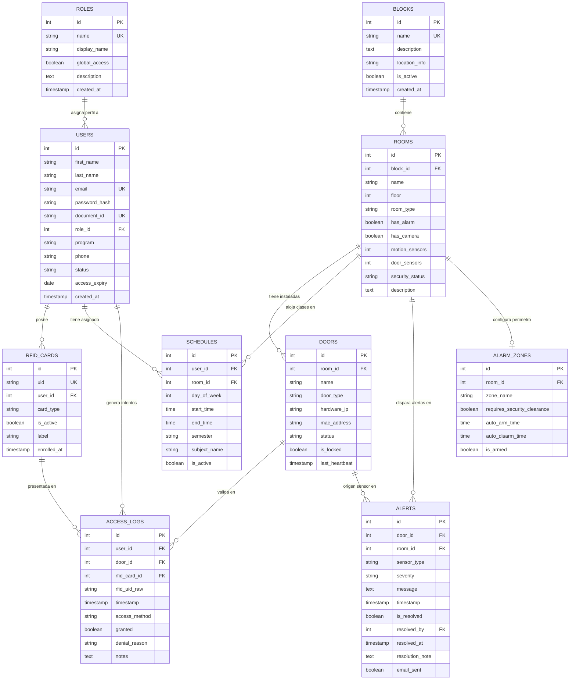

# 🗄️ Arquitectura y Modelo de Base de Datos

## Ecosistema Inteligente de Control de Acceso RFID y Monitoreo Institucional
**Corporación Universitaria Lasallista — Caldas, Antioquia**  
**Motor Principal:** PostgreSQL 16 (`rfid_db`) | **Motor Secundario:** Almacén en Memoria Transparente (`memoryDb`)

---

## 1. Visión y Principios del Modelo de Datos

El diseño de datos del ecosistema resuelve tres desafíos fundamentales:
1. **Estructura Dinámica del Campus:** Los espacios físicos no están pre-grabados rígidamente en el código. Las tablas jerárquicas `blocks` $\rightarrow$ `rooms` $\rightarrow$ `doors` permiten expandir la cobertura física a cualquier nuevo bloque o laboratorio de la universidad.
2. **Jerarquía RBAC y Articulación Horaria:** Permite modelar tanto accesos globales irrestrictos (Rectoría, Fichas Maestras) como accesos condicionados a ventanas temporales exactas (`schedules`) para profesores y estudiantes.
3. **Resiliencia con Cero Tiempo de Inactividad (Dual Engine):** Toda la lógica de datos está duplicada en memoria dentro de [`src/server/config/db.js`](file:///home/victormcl/Documents/RFID/src/server/config/db.js). Si PostgreSQL no está instalado, se reinicia o sufre cortes de red, el sistema transmuta instantáneamente al almacenamiento en RAM sin arrojar error al usuario.

---

## 2. Diagrama Entidad-Relación (Mermaid)

---

## 3. Especificación de Tablas del Esquema

### 3.1 `roles` — Jerarquía de Permisos Institucionales
Define los niveles de privilegio del campus.
- `id` (SERIAL PRIMARY KEY)
- `name` (VARCHAR(50) UNIQUE NOT NULL): Identificador de rol (`admin`, `rector`, `professor`, `student`, `security`, `admin_staff`).
- `display_name` (VARCHAR(100) NOT NULL): Nombre legible para interfaz (ej. *"Profesor / Docente"*).
- `global_access` (BOOLEAN DEFAULT FALSE): `TRUE` permite apertura en cualquier puerta y horario (Rectoría, Seguridad).
- `description` (TEXT): Alcance y directrices operativas.

### 3.2 `users` — Comunidad Universitaria
Almacena directivas, docentes, alumnos y vigilantes.
- `id` (SERIAL PRIMARY KEY)
- `first_name`, `last_name` (VARCHAR(100) NOT NULL)
- `email` (VARCHAR(255) UNIQUE NOT NULL): Correo institucional `@lasallista.edu.co`.
- `password_hash` (VARCHAR(255) NOT NULL): Hash `bcrypt` para autenticación web (solo Admin y Celador).
- `document_id` (VARCHAR(50) UNIQUE NOT NULL): Cédula de ciudadanía o tarjeta de identidad.
- `role_id` (INTEGER REFERENCES roles(id) ON DELETE RESTRICT)
- `program` (VARCHAR(200)): Programa académico (ej. *"Ingeniería de Software"*).
- `status` (VARCHAR(20) DEFAULT 'active'): `'active'`, `'inactive'`, `'suspended'`.
- `access_expiry` (DATE): Fecha de expiración (útil para visitantes temporales).

### 3.3 `blocks` — Bloques del Campus
Representa los edificios universitarios.
- `id` (SERIAL PRIMARY KEY)
- `name` (VARCHAR(100) UNIQUE NOT NULL): *"Bloque A"*, *"Bloque B"*, *"Bloque C"*, *"Bloque Administrativo"*.
- `description` (TEXT): Propósito del bloque (ej. *"Laboratorios de Informática e Ingeniería"*).
- `location_info` (VARCHAR(255)): Ubicación geográfica en el campus.
- `is_active` (BOOLEAN DEFAULT TRUE)

### 3.4 `rooms` — Salas, Laboratorios y Oficinas
Espacios físicos pertenecientes a un bloque.
- `id` (SERIAL PRIMARY KEY)
- `block_id` (INTEGER REFERENCES blocks(id) ON DELETE CASCADE)
- `name` (VARCHAR(100) NOT NULL): *"Sala de Informática 1"*, *"Biblioteca Central"*, *"Admisiones"*.
- `floor` (INTEGER DEFAULT 1): Piso del edificio.
- `room_type` (VARCHAR(50)): `'lab_informatica'`, `'lab_ingenieria'`, `'biblioteca'`, `'administrativo'`, `'financiero'`.
- `has_alarm` (BOOLEAN DEFAULT FALSE): Si cuenta con alarma perimetral integrada.
- `has_camera` (BOOLEAN DEFAULT FALSE): Si cuenta con circuito cerrado de televisión.
- `motion_sensors` (INTEGER DEFAULT 0): Cantidad de sensores PIR de presencia.
- `door_sensors` (INTEGER DEFAULT 0): Cantidad de sensores magnéticos de puerta.
- `security_status` (VARCHAR(30) DEFAULT 'normal'): `'normal'`, `'armed'`, `'alert'`.

### 3.5 `doors` — Puertas Inteligentes con Hardware
Puntos de acceso equipados con lector RFID y electroimán.
- `id` (SERIAL PRIMARY KEY)
- `room_id` (INTEGER REFERENCES rooms(id) ON DELETE CASCADE)
- `name` (VARCHAR(100) NOT NULL): *"Puerta Principal — Sala Informática 1"*, *"Puerta Lateral Derecha"*.
- `door_type` (VARCHAR(30) DEFAULT 'main'): `'main'`, `'lateral'`, `'turnstile'`.
- `hardware_ip` (VARCHAR(45)): Dirección IPv4 o IPv6 asignada al ESP32 / Raspberry Pi.
- `mac_address` (VARCHAR(17)): Dirección física del controlador de hardware.
- `status` (VARCHAR(20) DEFAULT 'offline'): `'online'`, `'offline'`, `'maintenance'`.
- `is_locked` (BOOLEAN DEFAULT TRUE): Estado físico de la cerradura electromagnética.
- `last_heartbeat` (TIMESTAMPTZ): Última señal de vida recibida del hardware.

### 3.6 `rfid_cards` — Tarjetas y Fichas Maestras
Carnets físicos emitidos.
- `id` (SERIAL PRIMARY KEY)
- `uid` (VARCHAR(50) UNIQUE NOT NULL): Identificador único en formato hexadecimal (ej. `A1B2C3D4`, `11223344`).
- `user_id` (INTEGER REFERENCES users(id) ON DELETE CASCADE)
- `card_type` (VARCHAR(20) DEFAULT 'standard'): `'standard'` (docentes/alumnos) o `'master'` (vigilancia).
- `is_active` (BOOLEAN DEFAULT TRUE): Permite revocación instantánea en caso de pérdida.
- `label` (VARCHAR(100)): Etiqueta descriptiva (ej. *"Ficha Maestra Vigilancia"*).
- `enrolled_at` (TIMESTAMPTZ DEFAULT NOW())

### 3.7 `schedules` — Articulación Horaria
Reglas temporales para salas y docentes.
- `id` (SERIAL PRIMARY KEY)
- `user_id` (INTEGER REFERENCES users(id) ON DELETE CASCADE)
- `room_id` (INTEGER REFERENCES rooms(id) ON DELETE CASCADE)
- `day_of_week` (INTEGER NOT NULL): 1 = Lunes, 2 = Martes, 3 = Miércoles, 4 = Jueves, 5 = Viernes, 6 = Sábado, 7 = Domingo.
- `start_time` (TIME NOT NULL): Hora de inicio (ej. `07:00:00`).
- `end_time` (TIME NOT NULL): Hora de finalización (ej. `09:00:00`).
- `semester` (VARCHAR(20) DEFAULT '2026-2')
- `subject_name` (VARCHAR(150)): Nombre de la asignatura (ej. *"Programación Orientada a Objetos"*).
- `is_active` (BOOLEAN DEFAULT TRUE)

### 3.8 `access_logs` — Auditoría Forense de Entradas
Registro inmutable de cada interacción RFID.
- `id` (SERIAL PRIMARY KEY)
- `user_id` (INTEGER REFERENCES users(id) ON DELETE SET NULL)
- `door_id` (INTEGER REFERENCES doors(id) ON DELETE CASCADE)
- `rfid_card_id` (INTEGER REFERENCES rfid_cards(id) ON DELETE SET NULL)
- `rfid_uid_raw` (VARCHAR(50) NOT NULL)
- `timestamp` (TIMESTAMPTZ DEFAULT NOW())
- `access_method` (VARCHAR(30) DEFAULT 'rfid')
- `granted` (BOOLEAN NOT NULL): `TRUE` = Autorizado, `FALSE` = Denegado.
- `denial_reason` (VARCHAR(100)): `'denegado_no_registrado'`, `'denegado_tarjeta_inactiva'`, `'denegado_horario_no_valido'`, `'denegado_area_no_autorizada'`.
- `notes` (TEXT)

### 3.9 `alerts` — Registro de Alarmas e Intrusiones
Incidentes de seguridad y alarmas físicas.
- `id` (SERIAL PRIMARY KEY)
- `door_id` (INTEGER REFERENCES doors(id) ON DELETE CASCADE)
- `room_id` (INTEGER REFERENCES rooms(id) ON DELETE CASCADE)
- `sensor_type` (VARCHAR(50) NOT NULL): `'alarm_triggered'`, `'door_forced'`, `'tamper'`.
- `severity` (VARCHAR(20) DEFAULT 'critical'): `'low'`, `'medium'`, `'high'`, `'critical'`.
- `message` (TEXT NOT NULL)
- `timestamp` (TIMESTAMPTZ DEFAULT NOW())
- `is_resolved` (BOOLEAN DEFAULT FALSE)
- `resolved_by` (INTEGER REFERENCES users(id) ON DELETE SET NULL)
- `resolved_at` (TIMESTAMPTZ)
- `resolution_note` (TEXT)
- `email_sent` (BOOLEAN DEFAULT FALSE)

---

## 4. Estrategia de Indexación y Optimización (< 3 s SLA)

Para asegurar que las búsquedas no degraden la meta de respuesta de **3 segundos**:
1. `idx_rfid_cards_uid`: B-Tree en `rfid_cards(uid)` (Búsqueda en $O(\log n)$, < 2 ms).
2. `idx_access_logs_timestamp`: B-Tree descendente en `access_logs(timestamp)` para renderizado instantáneo del historial.
3. `idx_schedules_lookup`: Índice compuesto en `schedules(user_id, room_id, day_of_week, is_active)` para la validación horaria docente en tiempo de ejecución.
4. `idx_users_email`: B-Tree en `users(email)` para autenticación rápida de Administradores y Celadores.

---

## 5. Scripts de Configuración y Semillas
- **Creación de Esquema:** [`src/server/config/schema.sql`](file:///home/victormcl/Documents/RFID/src/server/config/schema.sql)
- **Datos Semilla Institucionales:** [`src/server/seeds/seed.sql`](file:///home/victormcl/Documents/RFID/src/server/seeds/seed.sql)
- **Automatización de Instalación:** [`setup-db.sh`](file:///home/victormcl/Documents/RFID/setup-db.sh)
