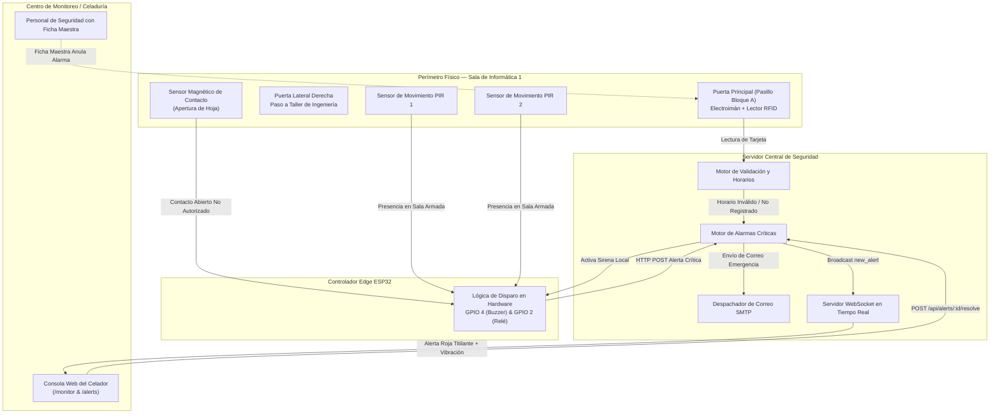

# 🛡️ Seguridad Física, Alarmas y Protección de Datos

## Ecosistema Inteligente de Control de Acceso RFID y Monitoreo Institucional
**Corporación Universitaria Lasallista — Caldas, Antioquia**

---

## 1. Arquitectura de Seguridad Integral

El sistema articula la seguridad lógica (cifrado, tokens JWT, RBAC) con la seguridad física de los recintos universitarios (cerraduras electromagnéticas, sensores magnéticos de intrusión, detectores de movimiento y protocolos de alarma perimetral).

---

## 2. Protocolo de Seguridad en Sala de Informática 1 (Prototipo Piloto)

La Sala de Informática 1 fue seleccionada para el despliegue del prototipo inicial debido a su alto valor tecnológico y su ubicación estratégica:
- **Puerta 1 (Principal):** Comunica con el corredor central del Bloque A. Posee electroimán de 600 lbs y lector RFID para docentes y estudiantes.
- **Puerta 2 (Lateral Derecha):** Comunica con el Taller Práctico de Ingeniería. Posee cerradura electromagnética controlada por hardware.
- **Sensores Instalados:** 2 detectores de movimiento PIR volumétricos y 1 sensor de contacto magnético en la hoja de la puerta principal.

### Estados de Seguridad de la Sala:
1. **`normal` (Desarmada / En Clase):** Ocurre cuando hay una clase activa asignada en la tabla `schedules`. Las puertas abren al pasar el carnet del docente o estudiantes del grupo sin disparar sirenas.
2. **`armed` (Armada / Asegurada):** Ocurre fuera de los horarios de clase o en horas de la noche/madrugada. Toda detección de movimiento o apertura física sin aviso previo es considerada una intrusión crítica.
3. **`alert` (Alarma Disparada):** Estado de emergencia activado ante una vulneración de perímetro.

### Regla de Eficiencia y Desarme Exclusivo:
> [!IMPORTANT]
> **REGLA DE SEGURIDAD CRÍTICA:**  
> Si la Sala de Informática 1 se abre sin haber notificado previamente a seguridad para el desarmado manual, el sistema dispara una **alarma crítica continua** (buzzer local + alerta en pantalla).  
> **Esta alarma ÚNICAMENTE puede ser deshabilitada y restablecida desde el cuarto de control de seguridad** mediante la consola web del celador (`POST /api/alerts/:id/resolve`). Ningún estudiante o docente puede cancelar la alarma desde el aula.

---

## 3. Privilegios de Anulación: Fichas Maestras de Seguridad

Para garantizar que el personal de vigilancia y los cuerpos de socorro no queden atrapados ni disparen falsas alarmas durante rondas nocturnas o evacuaciones:
- Se emiten tarjetas con el atributo `card_type = 'master'` (ej. UID `AABBCCDD` rotulado como *"Ficha Maestra Vigilancia"*).
- Al aproximar una ficha maestra, el motor de validación:
  1. Concede acceso inmediato y destraba la cerradura durante 5 segundos.
  2. Inhibe el disparo de la alarma perimetral aunque la sala esté en estado `armed`.
  3. Registra el evento en auditoría con el nombre del guardia responsable.

---

## 4. Sistema de Alertas por Correo Electrónico (Nodemailer)

Cuando se produce un incidente de severidad `critical`:
- El módulo [`backend/src/services/emailService.js`](file:///home/victormcl/Documents/RFID/backend/src/services/emailService.js) genera un correo formateado en HTML con membrete institucional.
- **Destinatario:** Configurado en la variable `ALERT_EMAIL` (por defecto `vigilancia@lasallista.edu.co`).
- **Contenido del Mensaje:**
  - Nivel de Severidad (🚨 Crítica).
  - Recinto afectado (ej. *Sala de Informática 1*).
  - Puerta vulnerada (ej. *Puerta Principal*).
  - Fecha y hora exacta con zona horaria de Colombia (`America/Bogota`).
  - Tipo de sensor disparado (`door_forced`, `alarm_triggered`).
- **Tolerancia a Fallos:** Si las credenciales SMTP no están configuradas en el entorno de pruebas, el servicio registra la alerta de forma limpia en los logs de consola sin detener la ejecución del servidor.

---

## 5. Cumplimiento de la Ley 1581 de 2012 (Habeas Data)

El tratamiento de los datos personales (fotografías, cédulas, nombres completos y registros horarios) en este ecosistema se rige por la **Ley Estatutaria 1581 de 2012** y el Decreto Reglamentario 1377 de 2013 de la República de Colombia:
1. **Principio de Finalidad:** La captura del UID del carnet y los registros de acceso tienen como única finalidad salvaguardar la seguridad física de los activos universitarios y controlar el aforo en laboratorios.
2. **Seguridad y Confidencialidad:** Las contraseñas se almacenan mediante hashes unidireccionales `bcrypt`. Ninguna clave se guarda en texto plano.
3. **No Comercialización:** Los registros de auditoría (`access_logs`) son de uso estrictamente interno y no se comparten con terceras entidades.
4. **Restricción de Acceso:** La visualización de fotografías en el escáner está reservada exclusivamente al personal de portería para corroboración de identidad presencial.
