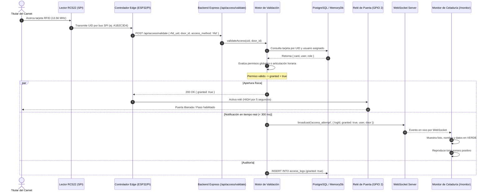
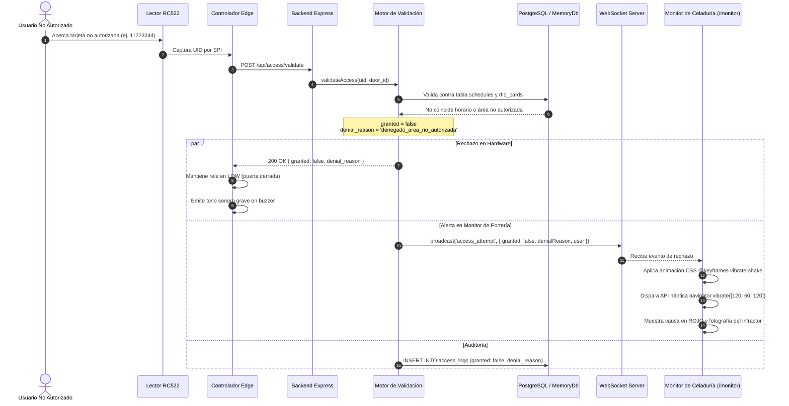
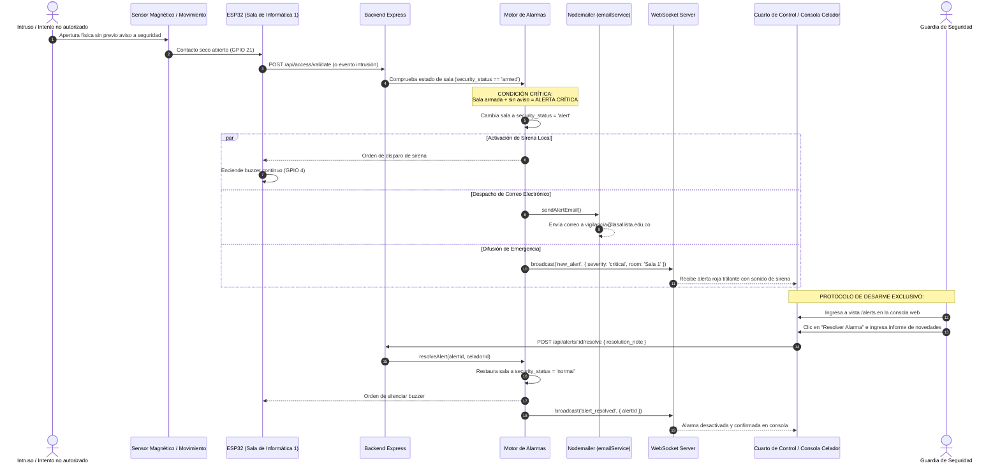
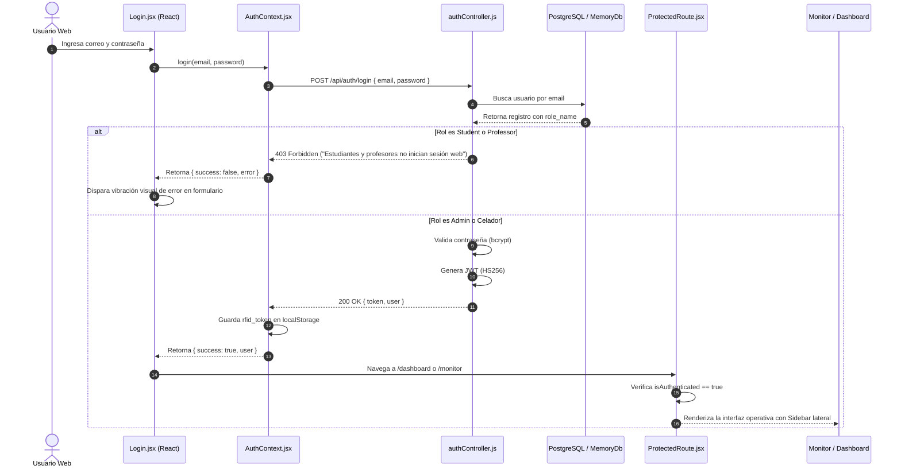

# 🔄 Diagramas de Secuencia del Sistema

## Ecosistema Inteligente de Control de Acceso RFID y Monitoreo Institucional
**Corporación Universitaria Lasallista — Caldas, Antioquia**

---

## SD-001: Validación de Acceso Exitoso en Puerta / Torniquete

Muestra el flujo completo desde que la tarjeta es detectada por la antena hasta que la cerradura se abre y el monitor del celador se actualiza en menos de 3 segundos.

---

## SD-002: Acceso Denegado con Animación de Vibración y Alerta Háptica

Representa el rechazo de un acceso (por tarjeta vencida, no registrada o intento fuera de horario) y la activación de los estímulos visuales y hápticos de alerta.

---

## SD-003: Disparo de Alarma Crítica en Sala de Informática 1 y Desarme por Seguridad

Ilustra la lógica de seguridad cuando una sala asegurada es vulnerada y la restricción estricta de que solo puede ser desarmada desde el panel del celador.

---

## SD-004: Autenticación Web y Protección de Rutas (Admin y Celador)

Demuestra la validación de credenciales en el login y la denegación automática a estudiantes o profesores.

