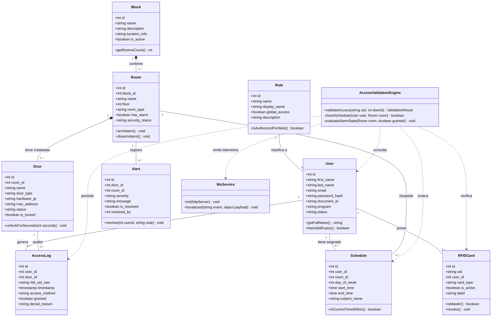
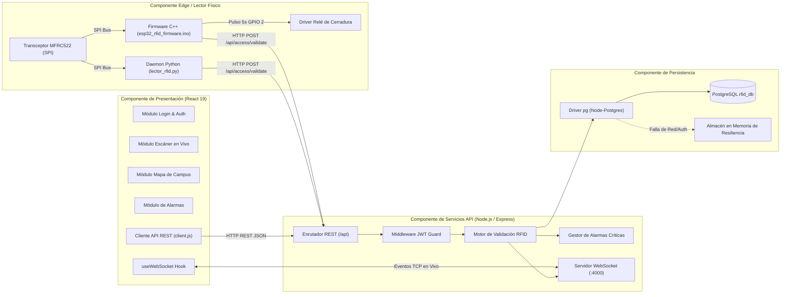

# 📐 Diagramas UML del Sistema

## Ecosistema Inteligente de Control de Acceso RFID y Monitoreo Institucional
**Corporación Universitaria Lasallista — Caldas, Antioquia**

---

## 1. Diagrama de Clases del Dominio (Mermaid)

Modelado orientado a objetos de las entidades del ecosistema institucional, sus relaciones de agregación y los controladores centrales del negocio.



---

## 2. Diagrama de Componentes del Sistema

Representa la modularidad de los subsistemas y los protocolos de comunicación que los interconectan.



---

## 3. Diagrama de Despliegue Físico en el Campus

Ilustra la distribución física de los nodos de hardware, el servidor de aplicaciones y las estaciones de seguridad en la Corporación Universitaria Lasallista.

```mermaid
graph TD
    subgraph PorteriaPeatonal ["Nodo 1: Portería Principal (Entrada Campus)"]
        PC_Celador["PC Estación de Guardia<br/>(Navegador Firefox / Linux)"]
        Torniquete["Torniquete Peatonal con CrowPi 3<br/>(Lector RFID MFRC522)"]
    end

    subgraph SalaInformatica1 ["Nodo 2: Prototipo Sala de Informática 1 (Bloque A)"]
        P1_ESP32["Controlador Puerta Principal<br/>(ESP32 + RC522 + Relé + Buzzer)"]
        P2_ESP32["Controlador Puerta Lateral Taller<br/>(ESP32 + Relé)"]
        SensoresSala["Sensores PIR x2 + Sensor Magnético"]
    end

    subgraph CentroDatos ["Nodo 3: Servidor Institucional (Cuarto de Servidores)"]
        ServerApp["Servidor de Aplicación Node.js (:4000)<br/>WebSockets + REST API Engine"]
        PostgresSrv["Servidor de Base de Datos PostgreSQL (:5432)"]
    end

    subgraph Decanatura ["Nodo 4: Bloque Administrativo"]
        PC_Admin["PC de Administración / Decanatura<br/>(Gestión de Horarios y Campus)"]
    end

    %% Conexiones físicas de red
    Torniquete -->|LAN Cableada / HTTP| ServerApp
    P1_ESP32 -->|WiFi Institucional (WPA2) / HTTP| ServerApp
    P2_ESP32 -->|WiFi Institucional (WPA2) / HTTP| ServerApp
    SensoresSala -->|Línea física de señal| P1_ESP32

    PC_Celador <-->|HTTP :5173 + WebSockets :4000| ServerApp
    PC_Admin <-->|HTTP :5173| ServerApp

    ServerApp <-->|TCP Socket :5432| PostgresSrv
```
