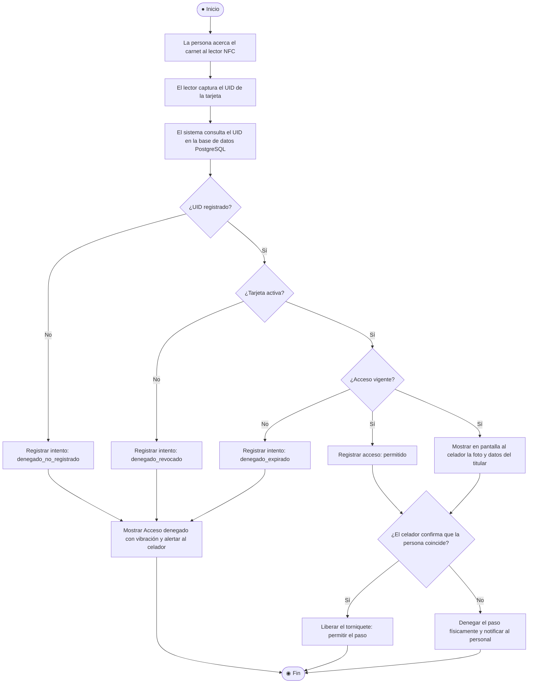

# 🔄 Diagrama de Actividades UML

**Proceso:** Ingreso peatonal mediante RFID/NFC con validación visual en tiempo real  
**Fuente:** Figura 1 del Documento de Especificación del Proyecto (Lasallista, 2026-2)

